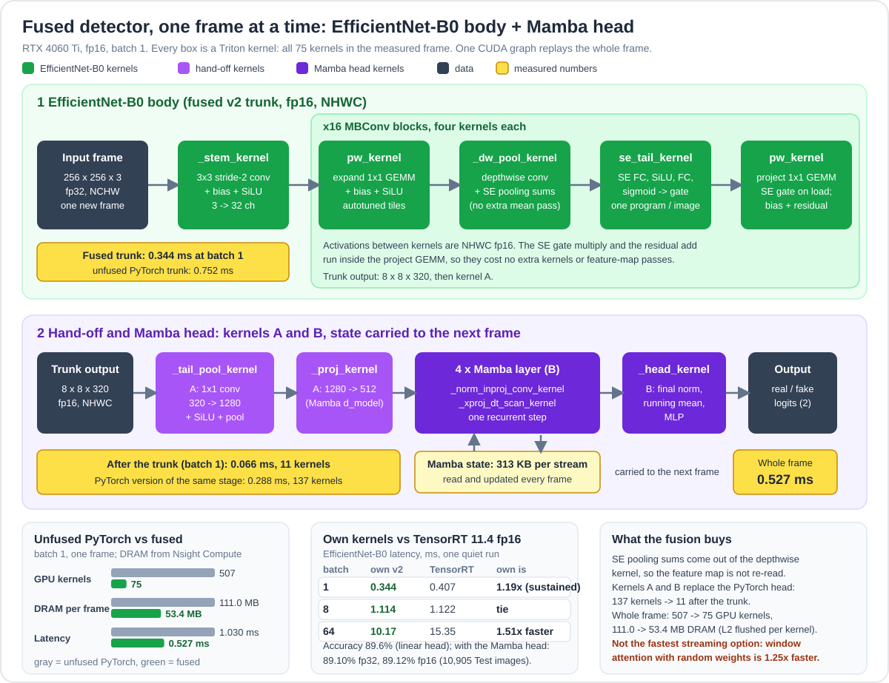
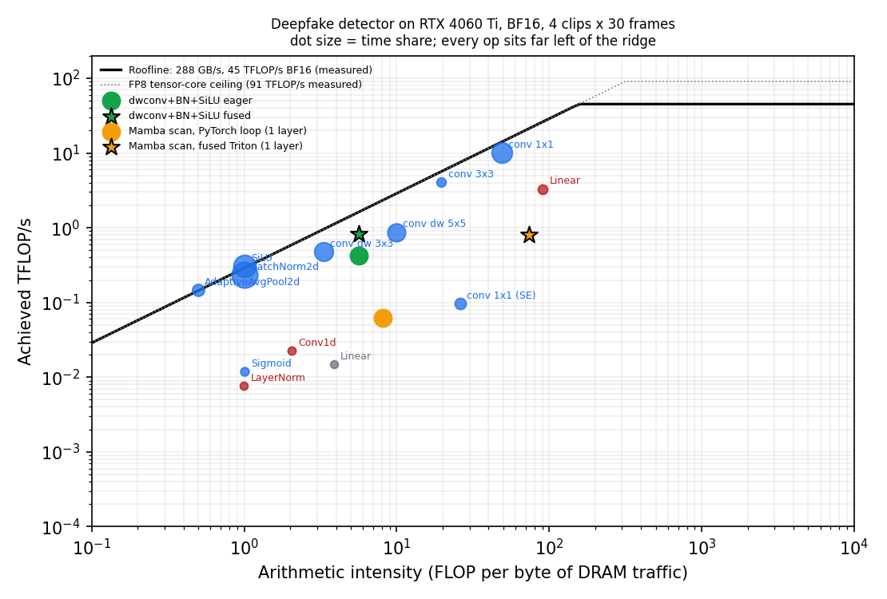

<p align="center"></p>

<h3 align="center">Triton and CUDA kernels that run a deepfake detector (EfficientNet-B0 + Mamba) in about half a millisecond per frame on one consumer GPU</h3>

<p align="center">
| <a href="docs/DETAILS.md"><b>Details</b></a> | <a href="WRITEUP.md"><b>Write-up</b></a> | <a href="#architecture"><b>Architecture</b></a> | <a href="#getting-started"><b>Reproduce</b></a> | <a href="https://github.com/chanakyagt/deepfake-detector-mamba"><b>Detector</b></a> | <a href="https://github.com/chanakyagt/detector-chip"><b>Detector chip</b></a> | <a href="https://github.com/chanakyagt/mamba-scan-accelerator"><b>Mamba scan accelerator</b></a> |
</p>

## About

inference-kernels profiles a video deepfake detector against the roofline of an RTX 4060 Ti (8 GB, sm_89) and replaces the slow parts with custom kernels. The detector is an EfficientNet-B0 body followed by a 4-layer Mamba head. The repository holds the profiling scripts, Triton and CUDA kernels, a fused per-frame streaming path, and every benchmark table behind the numbers below.

## Highlights

- Optimization ladder on the fine-tuned v2 detector: batch-1 latency from 3.73 ms (fp32 eager) to 0.60 ms, **6.2x**, measured back to back; batch-64 throughput 1,015 to 2,877 images/s.
- Fused EfficientNet-B0 (own Triton kernels) against TensorRT 11.4 fp16: **1.51x** lower latency at batch 64, a tie at batch 8, and 1.19x higher sustained throughput at batch 1.
- Streaming path, one new frame at a time: **0.527 ms** per frame at batch 1, 1.96x faster than unfused PyTorch, with 507 GPU kernels reduced to 75.
- DRAM traffic per frame at batch 1 drops from 111.0 MB to 53.4 MB (Nsight Compute, L2 flushed before every kernel).
- The Mamba state is 313 KB per stream and carried from frame to frame, so the cost per frame does not grow with video length.
- CUDA selective scan beats the official `mamba-ssm` kernel on 11 of 12 fp32 shapes.
- Accuracy is unchanged: 89.6% for the v2 model; 89.10% (fp32) and 89.12% (fp16) for the streaming path with the Mamba head, on 10,905 Test images.

## Architecture

<p align="center"></p>

Each frame runs as a chain of Triton kernels inside one CUDA graph. Every MBConv block uses four kernels: an expand GEMM, a depthwise kernel that also writes squeeze-and-excitation pooling sums, an SE tail kernel, and a project GEMM that applies the SE gate on load and adds the residual in its epilogue. Kernel A fuses the head convolution, SiLU, pooling and projection. Kernel B runs the four Mamba layers and the classifier head. The roofline that motivated this design:

<p align="center"></p>

## Results

All numbers are on one RTX 4060 Ti, WSL2, PyTorch 2.14, Triton 3.8.

| What | Result | How measured |
|---|---|---|
| v2 detector, batch-1 latency | 3.73 ms to 0.60 ms (6.2x); energy 0.119 to 0.048 J per image | MEASURED, back to back, `results/trained_ladder.md` |
| Fused v2 EfficientNet-B0 vs TensorRT 11.4 fp16 (default level) | 0.344 vs 0.407 ms at batch 1; 1.114 vs 1.122 ms at batch 8; 10.17 vs 15.35 ms at batch 64 | MEASURED, one quiet run, idle gate passed |
| Streaming frame, fp16, batch 1 | 0.527 ms vs 1.030 ms unfused PyTorch (1.96x); 1.415 vs 3.050 ms at batch 8 | MEASURED, CUDA graph, best of 3 trials of a 200-frame median |
| Stage after the trunk, batch 1 | 0.066 ms and 11 kernels vs 0.288 ms and 137 kernels in PyTorch | MEASURED, inside a CUDA graph |
| DRAM traffic per frame, batch 1 | 53.4 MB vs 111.0 MB; at batch 8, 196.7 vs 612.5 MB | MEASURED, Nsight Compute counters, `--cache-control all` |
| CUDA selective scan vs official `mamba-ssm` (fp32) | faster on 11 of 12 shapes, 1.67x to 14.85x with tuned settings | MEASURED, `compare_official/README.md` |
| First Triton work, 30-frame clip | 22.6 ms to 9.6 ms (2.3x), outputs match to 9e-7 | MEASURED, `WRITEUP.md` |

## Getting Started

Linux or WSL2 with an NVIDIA GPU (Triton needs Linux). Clone [deepfake-detector-mamba](https://github.com/chanakyagt/deepfake-detector-mamba) next to this repository, or set `DETECTOR_REPO` to its path.

```bash
pip install -r requirements.txt
python env/measure.py
python kernels/test_kernels.py
python kernels/bench_kernels.py
python profiling/profile_detector.py --dtype bfloat16 --clips 4
python quantization/fp8_int8_linear.py
python roofline/roofline_plot.py
```

Fused model and streaming path (run inside WSL; from Git Bash set `MSYS_NO_PATHCONV=1`):

```bash
cd fused_model
bash run.sh $PWD/check_blocks.py 64
bash run.sh $PWD/bench_all.py --seconds 20

cd ../fused_stream_v2
bash run.sh check.py
bash run.sh bench.py
```

Paths for trained checkpoints and scratch files come from environment variables: `DFM_CKPT_ROOT`, `DFM_SCRATCH`, `DETECTOR_REPO`, `MAMBA_OFFICIAL_REPO`, `MAMBA_OFFICIAL_BUILD` and `TEST_DIR`. Their defaults and meanings are listed in [docs/DETAILS.md](docs/DETAILS.md).

## Repository layout

| Folder | Contents |
|---|---|
| `kernels/` | Triton kernels: selective scan, depthwise conv + BN + SiLU, fused tail and projection, fused Mamba step |
| `cuda/` | CUDA C++ selective scan, with build, test and benchmark scripts |
| `fused_model/` | Fused fp16 EfficientNet-B0 (v1, v2) and the TensorRT comparison |
| `fused_stream_v2/` | Fused EfficientNet-B0 v2 + Mamba streaming path, correctness, timing and Nsight Compute traffic |
| `compare_official/` | Race against the official `mamba-ssm` scan kernel |
| `trained/` | Optimization ladder, per-layer profiling and TensorRT benchmark scripts for the trained models |
| `stream/` | Earlier streaming pipeline and tests |
| `quantization/` | FP8 and INT8 linear layers; per-layer quantization study |
| `profiling/`, `env/`, `roofline/` | Per-layer profile, measured hardware ceilings, roofline plot |
| `results/` | JSON and Markdown tables behind every number |

## Limitations

- The fused streaming path is not the fastest streaming option measured: a 30-frame window-attention baseline with untrained random weights is 1.25x faster at batch 1.
- The TensorRT comparison covers EfficientNet-B0 only, fp16, on one GPU; at batch 8 the two are tied.
- The DRAM figures use L2 flushed before every kernel, so a real stream with a warm L2 moves less.
- The CUDA scan loses at one long sequence (B1 E1024 T3000: 0.94x), and three batch-1 long-sequence rows become losses when the L2 cache is flushed before every call.
- Most of the batch-1 gain in the optimization ladder comes from the CUDA graph, not from the custom kernels; INT8 and FP8 on the head make the model slower.
- All timings are from one RTX 4060 Ti 8 GB under WSL2; other GPUs are untested.

## Related repositories

- [deepfake-detector-mamba](https://github.com/chanakyagt/deepfake-detector-mamba): the detector, EfficientNet-B0 + Mamba head, trained with DiLoCo.
- [detector-chip](https://github.com/chanakyagt/detector-chip): 8-bit accelerator for the EfficientNet-B0 trunk, written in Amaranth.
- [mamba-scan-accelerator](https://github.com/chanakyagt/mamba-scan-accelerator): CNN + Mamba hardware/software co-design.

## License

MIT
