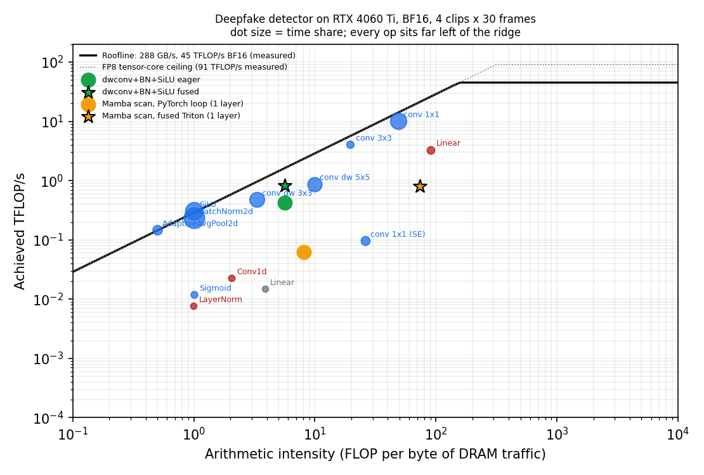

# Where the deepfake detector's time goes on an RTX 4060 Ti, and two kernels that fix most of it

> **Read this first (12 November 2026).** The table in the section "CUDA vs Triton vs PyTorch loop" below, and the "3.84x / 3.96x CUDA vs Triton" figures in it, are **superseded**. They compared a tuned CUDA kernel against untuned Triton, timed per call (including launch cost). Do not quote them. The fair comparison is the race against the official Mamba kernel in [`compare_official/README.md`](compare_official/README.md) (fp32: 11 of 12 shapes faster, one loss). The section "Current results" at the end of this file holds the official race, the optimization ladder, the CUDA kernel and the fused streaming kernel.

November 2026. All numbers come from the scripts in this repository, run on one RTX 4060 Ti 8 GB (Ada, sm_89) under WSL2 with PyTorch 2.14 and Triton 3.8. The desktop was in normal use, so repeated runs vary by roughly 5-10%. The model is the capstone detector from [deepfake-detector-mamba](../deepfake-detector-mamba), in its November 2026 rewrite (`dfmamba` package): EfficientNet-B0 on each of 30 face frames, 4 Mamba layers across the frames, and an MLP head. Weights are untrained (random init), which does not change timing. The baseline in every comparison forces the detector's plain PyTorch scan loop (`scan_impl = "ref"`), so it never silently uses a fused kernel.

## 1. The question

Which parts of the detector are limited by memory bandwidth, which by compute, and which by something else? And can a custom kernel move the slow parts closer to what the hardware allows?

## 2. Hardware ceilings (measured, `env/measure.py`)

| | Value |
|---|---|
| DRAM bandwidth, spec (128-bit x 18 Gbps) | 288 GB/s |
| DRAM read bandwidth, measured (large `sum`) | 272 GB/s |
| BF16 tensor-core matmul, measured (8192^3) | 45.1 TFLOP/s |
| FP8 (e4m3) tensor-core matmul, measured (8192^3, `torch._scaled_mm`) | 90.6 TFLOP/s |
| Ridge point (BF16 peak / spec bandwidth) | 157 FLOP/byte |

An operation that does fewer than about 157 floating-point operations per byte it moves to or from DRAM cannot use the full tensor cores on this card. It is limited by memory bandwidth, or by something slower.

## 3. Finding: nothing in this model is compute-bound

The per-op profile (`profiling/per_layer_table.md`, 4 clips x 30 frames, BF16) times every operation in isolation and models its FLOPs and minimum DRAM traffic:

| Kind | Share of op time | FLOP/byte | Achieved | What limits it |
|---|---|---|---|---|
| BatchNorm (49 ops) | 20% | 1.0 | 234 GB/s | bandwidth: a full read + write of the activation just to scale and shift it |
| Mamba selective scan, Python loop (4 layers) | 27% | 8.5 | 7 GB/s | kernel launches: several small GPU kernels per time step x 30 steps x 4 layers |
| SiLU (49 ops) | 14% | 1.0 | 304 GB/s | bandwidth: another full read + write |
| 1x1 convolutions | 12% | 49 | 207 GB/s | bandwidth (still below the 157 ridge) |
| Depthwise 3x3 and 5x5 convolutions | 18% | 3-10 | 88-144 GB/s | bandwidth, at one third to one half of what the card can do |

The highest-intensity layers (1x1 convolutions at 49 FLOP/byte, Mamba linears at 90) are still below the ridge point. **The tensor cores are mostly idle, and the cost is moving activations through DRAM and launching kernels.** That also means lower precision for compute (FP8) cannot help much here (section 6).

At 1 clip the picture shifts further toward launch overhead. Capturing the unmodified model in a CUDA graph (which replays all kernels without the CPU issuing them one at a time) cut a forward pass from 22.6 to 11.3 ms. At 4 clips the same trick saved only 11% (57.2 to 50.9 ms), because the GPU is busy long enough to hide the launches.



## 4. Kernel 1: fused Mamba selective scan (`kernels/selective_scan.py`)

**Problem.** The scan computes, for every frame t, `h = exp(delta*A) * h + delta*B*x` and `y = C.h + D*x`. The PyTorch version builds two tensors of shape (batch, frames, 1024, 16) in DRAM and then loops over frames in Python, launching several small kernels per frame.

**Kernel.** One Triton program owns 64 channels of one sequence. It keeps the 64 x 16 state `h` in registers for the whole sequence, computes `exp(delta*A)` and `delta*B*x` on the fly, and reads `x`, `delta`, `B`, `C` once and writes `y` once. This is the same idea as the hardware-aware scan in the Mamba paper: the large intermediate never touches DRAM. The recurrence runs in FP32 even when inputs are BF16.

| One layer, 30 frames | PyTorch loop | Fused | Speedup | DRAM for the scan state |
|---|---|---|---|---|
| batch 1 | 4.02 ms | 0.30 ms | 13.3x | 7.9 MB -> 0.37 MB |
| batch 4 | 4.42 ms | 0.34 ms | 13.1x | 31.5 MB -> 1.5 MB |
| batch 1, 300 frames | 40.3 ms | 0.42 ms | 96x | 79 MB -> 3.7 MB |
| batch 1, 3,000 frames | 400 ms | 3.4 ms | 116x | 786 MB -> 37 MB |

The PyTorch loop's time barely changes between batch 1 and batch 4, which confirms it is bound by launches, not by data. The fused kernel's time grows little from 30 to 300 frames (0.30 to 0.42 ms) and then roughly linearly (3.4 ms at 3,000), while the state it carries stays fixed at 64 KB per sequence per layer.

## 5. Kernel 2: fused depthwise conv + BatchNorm + SiLU (`kernels/fused_dwconv_bn_silu.py`)

**Problem.** Each of EfficientNet-B0's 16 depthwise blocks runs three kernels: the convolution writes its output to DRAM, BatchNorm reads it and writes it back, SiLU reads it and writes it again.

**Kernel.** BatchNorm is folded into the convolution weights and bias at load time (inference only). One Triton kernel then computes the depthwise convolution, adds the bias, applies SiLU and writes the result once. The block size adapts to the feature-map size so small 7x7 maps do not leave most threads idle.

Across the 16 blocks at 30 frames: **4.87 ms -> 2.49 ms (1.96x)**. The best blocks reach 76-80% of the 288 GB/s spec bandwidth, counting only the bytes that must move; the small 14x14 and 7x7 maps with 5x5 kernels reach only 22-30%. Full per-shape table: `kernels/results/bench.md`.

## 6. Whole model

| Forward pass, 30 frames per clip, BF16 | 1 clip | 4 clips |
|---|---|---|
| Original | 22.6 ms (44 clips/s) | 57.2 ms (70 clips/s) |
| + fused depthwise blocks | 23.1 ms | 45.2 ms |
| + fused scan | 11.3 ms | 50.8 ms |
| + both | 9.6 ms (104 clips/s) | 39.1 ms (102 clips/s) |
| + both + CUDA graph | 8.0 ms (125 clips/s) | 38.0 ms (105 clips/s) |

The two kernels help in different regimes. At 1 clip, the scan's launch overhead dominates, so fixing the scan matters and the faster convolution does not (the GPU was waiting on the CPU anyway). At 4 clips, the GPU is busier, so the faster convolution matters most (21% off the forward pass) and the scan still helps, but less (11%), because part of its launch overhead is hidden. Together they give **2.3x at 1 clip and 1.5x at 4 clips**. With both kernels in place, the whole model matches the PyTorch model to a max logit difference of 9e-7 in FP32 (`kernels/test_kernels.py`).

## 7. Precision: what FP8 and INT8 do here (`quantization/`)

| 4 clips x 30 frames | Linear weights | Mamba output error vs FP32 | Mamba + head time |
|---|---|---|---|
| BF16 | 22.8 MB | 1.0% | 2.1 ms |
| FP8 e4m3 (per-tensor scales), Mamba + projection linears | 11.5 MB | 8.4% | 5.2 ms |
| INT8 weight-only (per-channel scales) | 11.5 MB | 1.6% | 2.9 ms |

- **FP8 made it slower, not faster.** These matmuls have only 120 rows (4 clips x 30 frames), so they are tiny and launch-bound. Quantizing activations on the fly adds an absolute-max reduction, a scale and a cast before every matmul, which costs more than FP8 tensor cores save. Swapping the head linears too ("FP8 all linears" in `quant.md`) made the tail slower still, 7.2 ms.
- **FP8 with one scale per tensor lost too much precision.** The 8.4% feature error is roughly eight times BF16's. Per-channel or per-row scales would be the next thing to try.
- **INT8 weight-only kept accuracy close to BF16** (1.6% vs 1.0%) and halved weight bytes. But dequantizing in PyTorch before each matmul makes it slower. It would need a fused dequantize-and-multiply kernel to pay off.
- **The scan recurrence stayed in FP32 throughout.** The decay `exp(delta*A)` is multiplied 30 to 3,000 times in a row, which is exactly where low precision compounds.

These error numbers measure numerical drift on untrained weights. They are not detection accuracy. Per-layer quantization on a trained model, with Test accuracy, is in `results/quant_layerwise/` (see README.md); that work is still running.

## 8. What did not work, and what I would do next

- FP8 and INT8 linears, as above.
- `torch.compile` on the conv + BN + SiLU sequence was *slower* than eager in total (6.2 ms vs 4.9 ms for the 16 blocks). It did beat the hand-written kernel on 4 of 16 shapes, all stride-1 5x5 blocks on 28x28 and 14x14 maps (one by only 0.001 ms), and lost to it on the other 12.
- The first version of the depthwise kernel used a fixed block of 256 output pixels and was almost 2x slower than PyTorch on 7x7 maps (49 pixels per program, so 80% of lanes masked off). Sizing the block to the map fixed it.
- The fused scan is still far below the roofline: at batch 4 and 30 frames it moves 1.49 MB in 0.34 ms, about 4 GB/s. It walks the 30 frames one after another, and 4 sequences x 16 channel blocks = 64 programs only lightly fill 34 SMs. A chunked parallel scan would expose more parallelism.
- BatchNorm and SiLU together are 35% of the op time at 4 clips. The fused kernel covers only the 16 pairs after depthwise convolutions; the ones after the stem and the 1x1 convolutions are still separate passes. Folding BatchNorm into the 1x1 convolution weights and applying SiLU in that matmul's epilogue (the last step of the kernel, before the result is written) is the next biggest win.

## Reproduce

```bash
python env/measure.py
python profiling/profile_detector.py --dtype bfloat16 --clips 4
python kernels/test_kernels.py
python kernels/bench_kernels.py
python quantization/fp8_int8_linear.py
python roofline/roofline_plot.py
```


## Hardware counters and a CUDA C++ kernel

This section adds what a profiler would measure and a kernel written directly in CUDA C++ rather than Triton. Status when written: the profiler is blocked, and the CUDA kernel is built but its correctness and timing runs were queued behind other jobs on the shared GPU when this section was first written; they have since run (no numbers below are estimated).

### Hardware counters: blocked by the GPU driver

Nsight Compute (`ncu` 2026.2.1, from the CUDA 13.3 toolkit at `/usr/local/cuda/bin`) is installed in WSL2, and so is Nsight Systems (`nsys`). A trivial profile of a PyTorch elementwise kernel fails with this exact message:

```
==ERROR== ERR_NVGPUCTRPERM - The user does not have permission to access NVIDIA GPU Performance Counters on the target device 0.
```

The driver only lets administrators read the hardware performance counters unless a setting is changed on the Windows side (NVIDIA Control Panel, "Developer", "Manage GPU Performance Counters", allow access for all users). I did not change any system or driver setting, so there are no measured DRAM-byte, occupancy, L2 or FLOP counters in this repository yet, and no measured roofline. The roofline in section 3 remains the modelled one (minimum bytes from tensor shapes, time from CUDA events).

Once the setting is changed, `cuda/ncu_targets.py` runs one launch of each target (`triton_scan`, `cuda_scan`, `fused_dw`, `unfused_dw`) after warm-up, for example:

```bash
ncu --metrics gpu__time_duration.sum,dram__bytes_read.sum,dram__bytes_write.sum,dram__throughput.avg.pct_of_peak_sustained_elapsed,sm__throughput.avg.pct_of_peak_sustained_elapsed,sm__warps_active.avg.pct_of_peak_sustained_active,launch__registers_per_thread,lts__t_sector_hit_rate.pct,sm__sass_thread_inst_executed_op_ffma_pred_on.sum python cuda/ncu_targets.py cuda_scan
```

What those counters mean: **DRAM throughput %** is how much of the card's 288 GB/s memory bandwidth the kernel actually used while it ran. **Occupancy** is how many warps (groups of 32 threads) are resident on a streaming multiprocessor (SM, one of the 34 compute units) compared with the maximum of 48. **Registers per thread** are the fastest storage on the chip; the more a thread uses, the fewer threads fit on an SM at once. **L2 hit rate** is the share of memory requests answered by the 32 MB on-chip L2 cache instead of DRAM. Note that `ncu` also locks the GPU clocks to a base value and runs kernels one at a time, so its durations are not comparable with CUDA-event timings taken at boost clocks.

### CUDA C++ selective scan (`cuda/selective_scan.cu`)

The kernel does the same computation as the Triton one (`h = exp(delta*A)*h + delta*B*x`, `y = C.h + D*x`, FP32 state) but with explicit control of threads, registers and shared memory:

- Each thread owns one channel (or a slice of one channel's 16 states, see below) and keeps its state and its row of `A` in registers for the whole sequence.
- `x`, `delta` and `y` are laid out with channels contiguous, so consecutive threads touch consecutive addresses (coalesced: one memory transaction serves a whole warp).
- `B` and `C` are the same for every channel, so a block loads 32 time steps of them once into shared memory (fast on-chip memory shared by the block) and every thread reads them from there.
- `exp` uses the fast hardware instruction `__expf`.
- A template parameter `S` splits one channel's 16 states over `S` neighbouring lanes (1, 2, 4, 8 or 16) and sums the partial `C.h` products with warp shuffles (`__shfl_xor_sync`, register-to-register exchange inside a warp). `S = 1` is the plain one-thread-per-channel design. A larger `S` creates more threads, which matters at batch 1 where there are only 1,024 channels for 34 SMs.
- Input and output can be FP32 or BF16 (`__nv_bfloat16`); the arithmetic is always FP32.
- It is built with `torch.utils.cpp_extension.load` (`cuda/build.py`, nvcc 13.3 for sm_89, C++20 as PyTorch 2.14 requires). Block size and `S` are launch arguments, so one build serves the whole sweep.

Files: `cuda/test_cuda_scan.py` checks it against `dfmamba.ssm.scan_reference` and the Triton kernel (max absolute error, FP32 and BF16, 30/300/3000 frames, batch 1 and 4); `cuda/bench_cuda_scan.py` times it against Triton and the PyTorch loop (median of 200 CUDA-event runs, fewer for the slow loop), sweeps channels-per-block and `S` for every shape, records registers, shared memory and theoretical occupancy per configuration (from `cudaFuncGetAttributes` and the occupancy API, not from `ncu`), and stores the GPU clocks and temperature in `results/ncu/cuda_scan_bench.json`.

```bash
python cuda/test_cuda_scan.py
python cuda/bench_cuda_scan.py
```

### CUDA scan correctness (measured, `cuda/test_cuda_scan.py`, `results/ncu/cuda_scan_correctness.json`)

Inputs come from a real `SelectiveSSM` block (d_inner 1024, d_state 16); the reference is `scan_reference` in FP32. Five (channels-per-block, S) configurations were checked at every shape.

| Case | Max absolute error vs PyTorch reference | Output scale |
|---|---|---|
| FP32 I/O, 30 frames, batch 1 and 4 | 2.4e-7 to 9.5e-7 | max |y| about 4.7 to 5.8 |
| FP32 I/O, 300 frames | 6.0e-7 to 9.5e-7 | about 6.5 |
| FP32 I/O, 3000 frames | 1.4e-6 to 1.5e-6 | about 6.9 to 7.3 |
| BF16 I/O, all shapes | 1.5e-2 to 1.6e-2 | equal to the BF16 rounding of the output itself |

The FP32 CUDA kernel stays within 1e-6 of Triton at 30 and 300 frames and within 1.0e-6 at 3000 frames, the same size as Triton's own error against the reference. The BF16 error equals the error of simply rounding the exact answer to BF16, so the kernel adds nothing beyond the output format. The timing results follow in the next subsection (superseded by the official-kernel race).

### CUDA vs Triton vs PyTorch loop (SUPERSEDED, do not quote; kept as the record of the old method; `results/ncu/cuda_scan_bench.json`)

CUDA-event timing, median of 200 runs (PyTorch loop: 200, 50 and 10 runs for 30, 300 and 3000 frames), FP32 inputs already prepared, one Mamba layer (1024 channels, 16 states). The GPU read 4% utilisation, 55 C, before the run (the 3-sample idle gate passed); it read 24% at 57 C and 2580 MHz afterwards, so a desktop process may have started during it. Each CUDA row uses the fastest configuration found by the sweep for that shape, so the CUDA column is tuned per shape and Triton's is not.

| Batch | Frames | PyTorch loop ms | Triton ms | CUDA FP32 ms | CUDA BF16 ms | best (channels/block, S) | CUDA vs Triton | CUDA vs loop |
|---|---|---|---|---|---|---|---|---|
| 1 | 30 | 2.704 | 0.0594 | 0.0375 | 0.0092 | (16, 4) | 1.58x | 72x |
| 4 | 30 | 2.506 | 0.0604 | 0.0372 | 0.0120 | (64, 1) | 1.63x | 67x |
| 1 | 300 | 27.06 | 0.1882 | 0.0490 | 0.0377 | (16, 2) | 3.84x | 552x |
| 4 | 300 | 26.66 | 0.1760 | 0.0621 | 0.0430 | (16, 2) | 2.83x | 429x |
| 1 | 3000 | 356.9 | 1.760 | 0.4441 | 0.3082 | (16, 2) | 3.96x | 804x |
| 4 | 3000 | 323.7 | 2.372 | 0.6820 | 0.5591 | (16, 2) | 3.48x | 475x |

Caveats. At 30 frames the kernels run 10 to 40 microseconds, which is close to the launch and timing noise of per-call CUDA events; the BF16 numbers at 30 frames (9 to 12 microseconds, faster than FP32 by 3x to 4x despite moving only half the bytes) are not explained by bytes alone and I did not investigate them further. The batch-4, 300-frame case moves 14.9 MB, which fits in the 32 MB L2 cache, so its analytic 240 GB/s (computed from minimum bytes and time, not measured) is above what DRAM alone could supply and says only that data stayed on chip. At 3000 frames and batch 4 (149 MB, larger than L2) the CUDA kernel's analytic rate is 218 GB/s against 272 GB/s measured read bandwidth, about 80%; Triton's is 63 GB/s. Batch 1 at 3000 frames is only 84 GB/s because 3000 dependent steps over 1,024 channels cannot occupy the GPU.

### Block size, channels per block and register pressure (measured by the benchmark sweep)

"Occupancy" below is theoretical: resident threads per SM from the CUDA occupancy API divided by the 1,536 maximum, using registers read from the compiled kernel. It is not an `ncu` achieved-occupancy counter.

| channels/block, S | threads/block | registers/thread | blocks per SM | occupancy |
|---|---|---|---|---|
| 16, 2 | 32 | 96 | 20 | 42% |
| 16, 4 | 64 | 48 | 20 | 83% |
| 32, 1 | 32 | 94 | 20 | 42% |
| 32, 2 | 64 | 56 | 18 | 75% |
| 64, 4 | 256 | 40 | 6 | 100% |
| 64, 16 | 1024 | 64 | 1 | 67% |
| 256, 1 | 256 | 64 | 4 | 67% |

With S = 1 a thread holds all 16 states plus 16 decay values, so it needs about 94 registers; at S = 2 that falls to 56 and at S = 4 to 40, because each lane keeps fewer states. Fewer registers allow more resident threads, but the sweep shows more occupancy is not the goal: the 100%-occupancy configurations (for example 16 channels, S = 8 or 16) were among the slowest at batch 4 (worst case 2.18 ms against 0.70 ms for the best at 3000 frames), because the extra warp shuffles to sum the partial products sit on the critical path of every one of the 3000 sequential steps. The winner at 300 and 3000 frames was always 16 channels per block with S = 2 (32 threads, 96 registers, 42% occupancy): small blocks give 64 to 256 blocks to spread across the 34 SMs, whereas 128 or more channels per block leaves most SMs idle at batch 1 (worst: 256 channels, S = 1, 1.70 ms against 0.44 ms). The default configuration (32, 2) is within 15 to 18% of the best at 300 frames but 1.8x slower at batch 1 and 3000 frames (0.82 against 0.44 ms), so the block shape matters more than the occupancy figure.

What limits each kernel, in hardware terms (reasoned from the timings above, not from counters, since `ncu` is blocked): the PyTorch loop is limited by kernel launches (2.5 to 2.7 ms for 30 steps, so about 90 microseconds per step, almost the same at batch 1 and 4). Triton and CUDA at 30 to 300 frames are limited by the length of the serial dependency chain, at batch 1 and 3000 frames about 0.59 microseconds per step for Triton against 0.15 for the tuned CUDA kernel. Only the large-batch, long-sequence case approaches the memory-bandwidth limit.


## Current results (added 12 November 2026)

Every number below comes from the file named next to it.

### The official kernel race (`results/official_compare.json`, `compare_official/README.md`)

Our CUDA selective scan against the official `mamba-ssm` kernel, in one harness: same inputs, same recurrence (no `z` gate, no `delta_softplus`), CUDA-graph timing, outputs checked against one fp32 reference (errors about 1e-6). RTX 4060 Ti, official commit e9594ce. fp32 is the quoted precision.

- Per-shape tuned launch settings: faster on 11 of 12 shapes, 1.67x to 14.85x. One loss: B1 E1024 T3000, 0.94x (the official kernel is about 7% faster).
- One fixed default setting (32 channels, split 2): faster on 11 of 12 shapes, 1.06x to 14.81x; on the losing shape 0.55x. The tuned column is the best case; the default column is the fairer one, because the official kernel has no settings to tune.
- vLLM's scan is bit-identical to the official kernel in all 24 rows, so it is the same kernel, not a second baseline.
- Rerun with one fixed setting (16 channels, split 2) for every shape, an idle check before every row, fp32 and bf16, and a cold-L2 variant (64 MB buffer written before each call): fp32 faster on 11 of 12 shapes (1.63x to 11.46x, one loss at B1 E1024 T3000, 0.94x); bf16 faster on all 12 (1.33x to 11.47x). Cold L2 shrinks the margins (1.03x to 4.96x on most rows) and turns three batch-1 rows into losses (fp32 T3000 0.91x; bf16 T300 0.89x and T3000 0.87x), so part of the warm bf16 advantage depends on the inputs staying in cache. The cold method adds an event-timing floor of about 7 microseconds (`warm_event_ms` in the JSON). Details: `compare_official/README.md`.
- Bandwidth above 288 GB/s in the tables is the 32 MB L2 cache holding the repeated inputs, not DRAM.
- Step core (single token): vLLM's Triton step time divided by ours is 0.89x to 1.03x (a tie within about 10%); the official Triton step kernel raised a TypeError on all 6 shapes, so there is no official data point.
- Our fused whole-layer step wins on 1 of 6 shapes (B1 E1024, 1.31x) and loses on the other 5 (down to 0.14x at batch 64 with E2048).

### The optimization ladder on the frozen model (`results/trained_parts/frozen_*_{perf,acc}.json`, summarised in `results/trained_ladder.md`)

Frozen EfficientNet-B0 features with the DiLoCo-trained Mamba head, Test set of 10,905 images, idle-gated runs. The fine-tuned (v2) ladder follows in its own table below.

| Step | batch-1 latency (ms) | batch-64 images/s | Test accuracy |
|---|---|---|---|
| R0s: fp32 eager, TF32 off | 6.85 | 1,324 | 0.7144 |
| R3: + bf16 autocast, channels_last, BatchNorm folded | 12.30 | 2,452 | 0.7152 |
| R4: + fused depthwise+BN+SiLU kernel (NCHW) | 8.17 | 2,126 | 0.7147 |
| R4b: same kernel, NHWC layout | 7.69 | 3,345 (not a clean run) | 0.7142 |
| R5: + fused Triton scan | 8.22 | 3,184 (not a clean run) | 0.7139 |
| R6: + CUDA graph | 1.17 | 3,612 | 0.7140 |
| R6b: + bf16 weights pre-cast | 0.78 | 3,706 | 0.7147 |

Overall: batch-1 latency 6.85 to 0.78 ms (8.8x), batch-64 throughput 1,324 to 3,706 images/s (2.8x), energy 0.0957 to 0.0371 J per image at batch 64 (raw), accuracy 71.44% to 71.47%.

Where the gain comes from: at batch 1 almost all of it is one step, the CUDA graph (R5 8.22 ms to R6 1.17 ms), which removes the cost of launching hundreds of small kernels from Python. Before the CUDA graph, no rung beat the fp32 eager baseline at batch 1 (R1 to R5 take 7.69 to 14.48 ms against 6.85 ms), so the custom kernels did not help there; bf16 autocast alone made batch 1 slower (10.79 ms against 5.64 ms for R0). At batch 64 the largest steps are bf16 autocast (R0 1,359 to R1 2,402 images/s) and the NHWC fused depthwise kernel (R4 2,126 to R4b 3,345), and the NCHW version of the fused kernel was slower than the rung before it (R3 2,452 to R4 2,126). The 8.8x baseline is fp32 eager with TF32 off; against plain fp32 eager (R0, 5.64 ms) it is 7.2x (5.64 / 0.78). Some rungs are marked in `trained_ladder.md` as sustained runs that were not clean.

### The optimization ladder on the fine-tuned (v2) model (`results/trained_parts/ft_effnet_b0_v2_*_{perf,acc}.json`, `results/trained_ladder.md`)

Same rungs on the fine-tuned EfficientNet-B0 (v2, the RTX 3090 retrain) with its linear head; Test set of 10,905 images, idle-gated runs, the best of 3 trials for latency. Rungs R2, R3, R5, R7 were not run for v2.

| Step | batch-1 latency (ms) | batch-64 images/s | batch-64 J/img (raw) | Test accuracy | AUC |
|---|---|---|---|---|---|
| R0s: fp32 eager, TF32 off | 3.73 | 1,015 | 0.1190 | 0.8962 | 0.9587 |
| R1: + bf16 autocast | 5.80 | 1,955 | 0.0658 | 0.8942 | 0.9500 |
| R4b: + fused depthwise+BN+SiLU (NHWC) | 5.20 | 2,794 | 0.0475 | 0.8959 | 0.9590 |
| R6: + CUDA graph | 0.73 | 2,840 | 0.0488 | 0.8959 | 0.9591 |
| R6b: + bf16 weights pre-cast | 0.60 | 2,877 | 0.0478 | 0.8958 | 0.9595 |
| R8: R6 + INT8 weight-only head Linears | 0.95 | 1,978 | 0.0652 | 0.8964 | 0.9596 |
| R9: R6 + FP8 head Linears | 0.91 | 1,978 | 0.0654 | 0.8963 | 0.9596 |

Overall (R0s to R6b): batch-1 latency 3.73 to 0.60 ms (6.2x), batch-64 throughput 1,015 to 2,877 images/s (2.8x), 0.1190 to 0.0478 J per image at batch 64 (2.5x), accuracy 0.8962 to 0.8958. The same pattern as on the frozen model: at batch 1 almost all of the gain is the CUDA graph (R4b 5.20 ms to R6 0.73 ms); the custom depthwise kernel is what helps at batch 64 (R1 1,955 to R4b 2,794 images/s); INT8 weight-only and FP8 on the head Linears make this model slower (0.95 and 0.91 ms against 0.73 ms at batch 1), because the head's matrices are too small to repay the extra conversion. Rows R0s, R0 and R1 were first measured on the v2 checkpoint that was lost in a WSL crash (Test 0.8944 / 0.9496); they were re-measured on the retrained checkpoint used by every other rung, and all rungs now agree (accuracy 0.8958 to 0.8962, AUC 0.9582 to 0.9595). The earlier apparent AUC jump between R1 and R4b came from mixing the two checkpoints.

### The CUDA kernel (`cuda/selective_scan.cu`)

Written directly in CUDA C++: each thread keeps one channel's recurrent state in registers, accesses are coalesced along channels, B and C are staged in shared memory in 32-step tiles, and a template parameter splits a channel's 16 states across lanes (combined with warp shuffles). Correctness (`results/ncu/cuda_scan_correctness.json`): fp32 error vs the PyTorch reference is at most about 1.5e-6 up to 3,000 frames. It has no `z` gate, no `delta_softplus` or `delta_bias`, one group of B and C, no variable-length batches and no initial state, so it is not a drop-in replacement for the official kernel. Hardware counters (Nsight Compute) are blocked on this machine, so statements about what limits it are inferred from timings.

### The fused streaming kernel (`results/stream_fused_correctness.json`)

Fuses the EfficientNet tail and the Mamba step for one-frame-at-a-time use. Correctness on the full Test set (10,905 images, `full_test` in the file):

- fp32: 0 flips (predictions that change class) against the fp32 original, for both the DiLoCo-trained and the fine-tuned model. Largest logit difference 1.9e-4 (DiLoCo) and 2.7e-5 (fine-tuned).
- bf16 (the timed mode): the fused path flips 68 predictions (DiLoCo) and 15 (fine-tuned) against the bf16 original, and 183 and 48 against the fp32 original. The bf16 original itself differs from fp32 on 179 and 41, so this is about the same drift as plain bf16, not an extra error from the fusion.

### A fused CNN-to-SSM streaming path (`results/stream_fused.json`, `results/stream_fused.md`, `stream/`)

Two Triton kernels for the part of the model after the EfficientNet trunk, used when frames arrive one at a time. Kernel A fuses the last 1x1 convolution (320 to 1280 channels), the SiLU, the average pool and the projection to the Mamba width. Kernel B steps all Mamba layers and the classifier head for one frame, keeping the recurrent state between frames. Per frame it replaces a recompute over the last 30 frames. The trunk itself uses the fused depthwise kernel from section 5.

Timing (final run, idle gate met: 3 samples at 5% utilisation before the first row; RTX 4060 Ti; DiLoCo-trained frozen-feature model; wall clock per new frame including a device sync, input already on the GPU; median of 200 CUDA-graph replays, p10 to p90 in brackets):

| Method (ms per frame) | bf16 batch 1 | bf16 batch 8 | fp32 batch 1 | fp32 batch 8 |
|---|---|---|---|---|
| Fused path (kernels A + B) | 0.904 (0.831-0.967) | 2.277 (2.238-2.896) | 1.812 (1.487-1.911) | 4.178 (4.145-4.388) |
| Unfused PyTorch recurrent step | 1.097 (1.068-1.212) | 3.026 (2.985-3.666) | 1.744 (1.609-2.134) | 4.808 (4.753-5.033) |
| Window of 30 features, fused scan | 1.177 (1.051-1.549) | 2.611 (2.572-2.886) | 1.659 (1.623-2.111) | 4.653 (4.616-4.890) |
| One attention layer over the 30-frame window | 1.328 (0.707-1.447) | 2.156 (2.133-2.458) | 1.346 (1.330-1.477) | 4.008 (3.969-4.235) |
| Trunk recomputed on all 30 frames | 8.409 | 80.756 | 17.085 | 161.124 |

What this says, without rounding it up:

- The fused path is faster than the unfused PyTorch recurrent step in 3 of 4 settings (1.21x bf16 batch 1, 1.33x bf16 batch 8, 1.15x fp32 batch 8) and 4% slower in fp32 batch 1 (1.812 against 1.744 ms; the p10 to p90 ranges overlap).
- **The windowed-attention baseline is as fast or faster in 3 of 4 settings** (bf16 batch 8: 2.156 against 2.277 ms; fp32 batch 1: 1.346 against 1.812; fp32 batch 8: 4.008 against 4.178). At bf16 batch 1 its median is slower (1.328 against 0.904) but its p10 is 0.707, so that row is bimodal and the two are not separable in this run. This attention layer has random weights and is a timing stand-in, not a trained detector, so no accuracy claim attaches to it.
- Recomputing the trunk on all 30 frames is 9x to 40x slower than any other method, which is the cost the recurrent form removes.
- Where the saving is: inside the graph at bf16 batch 1, the trunk takes 0.602 ms with the fused depthwise kernel (0.743 ms without), and the part after the trunk takes 0.067 ms with kernels A + B (0.008 + 0.059) against 0.286 ms for the PyTorch tail and Mamba step (4.2x). The after-trunk part is 11 GPU kernels instead of 140. Most of a frame is still the trunk, so the end-to-end gain is small.
- Analytic DRAM traffic per frame (bf16, batch 1): after the trunk 23.65 MiB fused against 29.52 MiB unfused, of which 23.52 MiB is weights and state that must move anyway; activation traffic falls from 6.01 to 0.14 MiB. Whole frame 102.32 against 125.54 MiB.
- Single run, one machine. Batch-1 rows vary by up to 2x between p10 and p90, so differences below about 20% at batch 1 should not be read as real. A first attempt of this benchmark crashed (illegal memory access) because `reset()` in two baselines reallocated the state buffers after the CUDA graph had been captured, leaving the graph writing to freed memory; it now zeroes the buffers in place. The old fine-tuned checkpoint (`ft_effnet_b0_mamba_3000`) was lost, so the two fine-tuned rows were skipped (`skipped` in the JSON). The tuning sweep (`results/stream_tuning.json`) showed the best kernel B variants within about 4% of each other at batch 1 (62.4 against 64.8 microseconds in bf16), so the default configuration was kept.
- The earlier development figures (1.12 against 1.61 ms, `results/stream_quick.json`, GPU not idle) are superseded by the table above.

### Streaming: one recurrent step per frame against recomputing the window (`results/streaming.md`, `results/streaming.json`)

Setting: a detector that gets a new frame every time step and must update its verdict. Options per new frame, with a 30-frame window, bf16, batch 1, trained 4-layer Mamba head, idle check passed (3 samples at 0%). All times are trunk plus head for one new frame.

| Strategy | ms per frame | frames per second |
|---|---|---|
| (a) recompute everything: trunk on 30 frames, then the 4-layer Mamba with the fused scan | 10.28 | 97 |
| (a2) cache the old features: trunk on 1 frame, Mamba over 30 features (fused scan) | 4.31 | 232 |
| (b) recurrent step, eager: trunk on 1 frame, one state update | 4.30 | 232 |
| (b2) recurrent step inside a CUDA graph | 1.39 | 718 |

So against the best recompute (a2, 4.31 ms) the CUDA-graph recurrent step is 3.1x faster; the eager recurrent step is no faster than the recompute, because it is launch-bound (many small kernels launched from Python). Head only (no trunk), per new frame: recomputing 4 Mamba layers with the fused scan takes 3.12, 5.72 and 10.85 ms at windows of 30, 300 and 3,000 frames, while the CUDA-graph recurrent step takes 0.203, 0.214 and 0.237 ms (15x to 46x faster, and nearly flat in the window length, as expected for a fixed-size state). The state is constant at 0.275 MB; the memory the recurrent step needs does not grow with the window. A one-layer attention head with a KV cache costs 0.47 to 0.49 ms per frame at any window and its cache grows from 0.06 MB (30 frames) to 5.86 MB (3,000 frames); recomputing that attention costs 0.48, 0.42 and 0.83 ms. The trunk (1.19 ms per frame) is what remains once the head is cheap, which is why the end-to-end gain is 3.1x and not 15x. Two sequences of real test features were used for the correctness check: stepping matches the parallel scan to 1.1e-6 to 1.7e-6 in fp32 and 1.2e-2 to 2.4e-2 in bf16 (logits of magnitude 0.44 to 1.0).

## 9. Per-layer quantization (`quantization/layerwise/`)

Section 7 quantized whole groups of layers on untrained weights and could only report numerical drift. This section uses the two trained detectors and answers three separate questions for every one of the 104 weight layers: **how much accuracy does it cost to shrink this layer, how much time does shrinking it save on this card, and which layers are worth shrinking?**

### 9.1 Words used in this section

- **Quantization** stores numbers with fewer bits. Here a weight or activation that was a 16-bit float becomes an 8-bit integer (int8, 256 levels) or an 8-bit float (FP8 e4m3, which keeps a tiny exponent so it covers a wide range coarsely) or a 4-bit integer (int4, 16 levels).
- **Weights** are the stored numbers the model learned. **Activations** are the numbers flowing between layers while it runs on an image.
- **W8A8** means 8-bit weights *and* 8-bit activations. **W8A16** means 8-bit weights with 16-bit activations (only the stored weights shrink). **W4A16** means 4-bit weights, 16-bit activations. **FP8** means FP8 for both.
- **Scale.** An int8 number only holds -127..127, so a real number x is stored as round(x / scale) and read back as that integer times the scale. A **per-tensor** scale is one scale for the whole tensor. A **per-output-channel** scale gives every output channel of a layer its own scale, so one channel with big weights does not squash the small weights of the others. **Group 64** (for int4) gives each run of 64 weights its own scale.
- **Calibration** is how the activation scale is chosen: run 512 *Train* images through the full-precision model, record the largest absolute value that enters each layer (averaged over batches of 64), and set the scale so that value maps to 127 (or 448 for FP8). The numbers are fixed afterwards. Test images are never used for this.
- **Fake quantization** (simulated) rounds the numbers to the quantized grid but keeps computing in FP32. It measures how much *accuracy* a format costs, not how fast it runs. Sections 9.4 and 9.5 use real low-precision kernels instead.
- **KL divergence** measures how far the quantized model's predicted probabilities have drifted from the full-precision model's (0 means identical). Unlike accuracy it needs no labels and is not noisy on 2,000 images, so it is the main sensitivity score.
- **AUC** is the chance that the model scores a random fake image above a random real one (0.5 = coin flip, 1.0 = perfect).
- **Pareto curve.** Each point is a configuration. A point is on the curve if no other configuration is both faster *and* at least as accurate. The **knee** is the point past which each extra bit of speed costs a lot of accuracy.
- **FLOP/byte (arithmetic intensity)**, **ridge point** and **bandwidth-bound** are as in section 2.

### 9.2 What was measured, on which model

- **Headline model (v2):** the ImageNet EfficientNet-B0 fine-tuned end to end on the face dataset (256x256 inputs, bicubic resize) with a linear head. It was retrained on a second GPU after a WSL crash lost the first copy, so all v2 numbers are for the retrained checkpoint. FP32 on the full Test set (10,905 images): accuracy 0.8962, AUC 0.9587.
- **Secondary model (diloco):** the frozen ImageNet trunk (224x224) plus the 4-layer Mamba head trained with DiLoCo. FP32 Test: accuracy 0.7144, AUC 0.7817. Only the sensitivity table, the real-versus-simulated check and an early speed run exist for it (section 9.8).
- BatchNorm is folded into the convolutions before anything is quantized, which is what a deployed model does. The folded FP32 model matches the original to 4e-5 in logits.
- Calibration: 512 *Train* images, fixed seed. Sensitivity subset: 2,000 *Test* images, fixed seed, same class balance as Test. Full-Test passes use all 10,905 images. Test images are never used for calibration.
- Every weight layer is a candidate: 82 in v2 (stem, 16 depthwise, 32 expand/project/top 1x1, 32 squeeze-and-excite (SE) 1x1, the head), 104 in diloco (adds the Mamba linears and its tiny 1-D convolution). Shapes, FLOPs, bytes and FLOP/byte at batch 1 and 64 are in `results/quant_layerwise/inventory_v2.md`.

### 9.3 Per-layer sensitivity (`sensitivity.py`)

Each layer is quantized alone (simulated in FP32) and the rest is left alone. Four schemes: W8A16, W8A8 (per-tensor activation scale), W4A16 (group 64), FP8 e4m3 for weights and activations. The full ranked table (82 layers x 4 schemes: KL, logit MSE, accuracy and AUC change) is `results/quant_layerwise/sensitivity_v2.md`.

The five most sensitive layers of the headline model (rank = mean rank of KL over the four schemes), with the change on the full Test set:

| Rank | Layer | KL W8A16 | KL W8A8 | KL W4A16 | KL FP8 | Full Test, W8A8: acc / AUC | Full Test, W4A16: acc / AUC |
|---|---|---|---|---|---|---|---|
| 1 | first depthwise 3x3 (`trunk.1.0.block.0.0`) | 7.5e-4 | **2.7e-1** | 3.2e-2 | 1.4e-2 | **-13.57 pp / -0.076** | -0.45 pp / +0.004 |
| 2 | first project 1x1, 32 to 16 channels (`trunk.1.0.block.2.0`) | 1.2e-4 | 1.2e-2 | **1.3e-1** | 6.9e-3 | -0.01 pp / -0.005 | **-7.41 pp / -0.012** |
| 3 | depthwise 3x3 in block 2.1 | 6.1e-5 | 2.2e-2 | 1.3e-2 | 2.0e-3 | -1.31 pp / -0.005 | -0.70 pp / -0.007 |
| 4 | depthwise 3x3 in block 2.0 | 1.3e-5 | 4.1e-2 | 7.5e-3 | 4.1e-3 | -2.45 pp / -0.012 | -0.30 pp / +0.000 |
| 5 | stem 3x3 convolution (`trunk.0.0`) | 1.9e-4 | 4.1e-4 | 5.3e-2 | 1.1e-2 | +0.03 pp / -0.000 | -3.64 pp / -0.018 |

(pp = percentage points of accuracy.) The 10 random other layers I also ran on the full Test set lose at most 0.30 pp (W8A8) and 0.17 pp (W4A16). What the tables say:

- **Weights alone are almost free.** W8A16 (8-bit weights, one scale per output channel) changes full-Test accuracy by at most 0.10 pp on any of the 20 layers tested.
- **Per-tensor 8-bit activations do the damage, concentrated in depthwise layers.** A depthwise layer's input has a few channels with very large values, so one scale for the whole tensor leaves most channels only a handful of levels. The first depthwise layer alone costs 13.6 pp of accuracy.
- **A fix that costs nothing for depthwise layers: one activation scale per channel.** In a depthwise convolution, output channel c depends only on input channel c, so a per-channel input scale folds into the per-channel weight scale and the arithmetic is unchanged. With it (called W8A8pc), the first depthwise layer's KL falls from 2.7e-1 to 1.7e-3 and its full-Test accuracy loss from 13.57 pp to 0.03 pp. Across all 16 depthwise layers on the full Test set, accuracy changes by -0.04 to +0.03 pp and AUC by -0.0005 to +0.0004. An ordinary 1x1 convolution cannot do this, because its input channels mix inside the multiply.
- **4-bit weights hurt thin layers.** The 32-to-16-channel project layer loses 7.4 pp, and the stem 3.6 pp.
- FP8 with one scale per tensor is mildly lossy everywhere (largest full-Test accuracy loss 0.57 pp, on the first depthwise layer).
- The head's final linear layer is essentially free at every scheme (KL at most 1.3e-5).

For the secondary diloco model (`sensitivity_diloco.md`) the picture is the same: the same first depthwise layer costs -8.5 pp at W8A8, the first project layer -7.3 pp at W4A16, and the Mamba `x_proj` and `dt_proj` layers are essentially free (KL below 4e-7).

**Do the real kernels behave like the simulation?** `validate_real.py` ran six layer/scheme pairs of v2 with the real bf16 kernels on 512 images (`validate_real_v2.md`). Plain bf16 already differs from FP32 by KL 3.9e-4 on these images, which is the floor. Single-layer real KL sits between 3.6e-4 and 6.1e-4 and the mean absolute logit difference between simulation and real kernel is 0.014 to 0.016, so single layers are indistinguishable from the floor. With every layer quantized (depthwise per-channel) the simulation gives KL 1.58e-2 and accuracy 0.8926, the real kernels 1.92e-2 and 0.8848 (FP32: 0.9004), so the simulation is a fair guide.

### 9.4 Real per-layer speed (`layer_speed.py`, `kernels/int8_dwconv.py`)

Timing: GPU time per call, from a CUDA graph that replays 20 calls back to back (median of 15 replays), so launch overhead is excluded; eager timings are in the JSON. The run waited for three `nvidia-smi` utilisation samples 5 s apart of 1%, 5%, 5%, ran under `flock -x`, and recorded clocks (210 MHz idle before, 2,805 MHz while running) and temperature in `layer_speed_v2.json`. Each "quantized" path includes everything needed to take a bf16 tensor in and give a bf16 tensor out: quantize the input, multiply, dequantize, add bias, SiLU if the layer has one. "bf16 best" is the faster of cuBLAS (plus a separate SiLU kernel) and my own Triton bf16 GEMM with the same fused epilogue as the int8 kernel, so a speedup is not just fusion in disguise. The quantized paths tried: a Triton int8 GEMM with quantize fused in front and dequantize/bias/SiLU fused behind; `torch._int_mm` plus a quantize kernel and a dequantize kernel; `torch._scaled_mm` (FP8) plus a quantize kernel.

Sum over all layers of one kind (milliseconds; wins = layers where the quantized path is faster):

| Layer kind (v2) | Batch | bf16 best | Quantized best | Speedup | Wins |
|---|---|---|---|---|---|
| 1x1 convolutions (32) | 1 | 0.120 | 0.120 | 1.00x | 16/32 |
| | 8 | 0.434 | 0.398 | 1.09x | 25/32 |
| | 64 | 4.415 | 4.149 | 1.06x | 26/32 |
| SE 1x1 on 1x1 maps (32) | 1 / 8 / 64 | 0.063 / 0.068 / 0.080 | 0.077 / 0.077 / 0.082 | 0.82x / 0.88x / 0.98x | 10, 5, 13 of 32 |
| Head linear 1280 to 2 | 1 / 8 / 64 | 0.0019 / 0.0042 / 0.0040 | 0.0054 / 0.0050 / 0.0060 | 0.35x / 0.84x / 0.67x | 0 of 1 |
| Depthwise (16), int8 input already prepared | 1 / 8 / 64 | 0.082 / 0.335 / 3.980 | 0.099 / 0.535 / 3.796 | 0.83x / 0.63x / 1.05x | 1, 0, 5 of 16 |
| Depthwise (16), including the quantize pass | 1 / 8 / 64 | 0.082 / 0.335 / 3.980 | 0.133 / 0.750 / 7.296 | 0.62x / 0.45x / 0.55x | 1, 0, 0 of 16 |

Layers that really get faster (batch 64, `layer_speed_v2.md`): the late, wide 1x1 convolutions. The 1152-to-320 project layer of the last block: 83.5 us to 44.5 us (1.9x); the 320-to-1280 top convolution: 78.6 us to 57.0 us (1.4x); the 480-to-80 project layers of blocks 4.1 and 4.2: 47.7 us to 26.5 us (1.8x each). At batch 1 the best single gain is 1.4 us (6.1 to 4.7 us, the 24-to-144 expand layers), which is within launch noise. For scale: the whole v2 network takes about 14.2 ms at batch 64 and 0.43 ms at batch 1, so the best layer saves 0.04 ms.

Why the rest do not:

- **Too small, or launch-bound.** An SE layer multiplies one short vector per image; the head layer has two outputs. Each takes 2 to 5 us, and the extra quantize kernel alone costs about 1.3 us.
- **Too few channels at high resolution.** The six 1x1 layers that lose at batch 64 are all in the first blocks (16 to 40 channels on maps from 128x128 down to 32x32), where the cost is moving the activations, which are bf16 at the layer boundary whatever the weights are.
- **Quantize and dequantize overhead.** On the 320-to-1280 top convolution at batch 64, `torch._int_mm` alone takes 91.7 us against 97.2 us for bf16 cuBLAS (6% faster); with its quantize and dequantize kernels the path takes 141 us, slower than bf16. FP8 `torch._scaled_mm` alone takes 43.8 us (2.2x faster), but with the quantize kernel and a separate SiLU the path takes 63 us. Fusing quantize and dequantize into the GEMM (my Triton kernel) gives 57 us, which keeps most of the gain.

**The int8 depthwise convolution does not make this card faster.** `kernels/int8_dwconv.py` is a Triton kernel: int8 activations and weights in, fp32 accumulation, per-channel scale, bias, optional SiLU, bf16 out, channels-last layout. `kernels/test_kernels.py` checks it against PyTorch on dequantized values on 8 shapes (fp32 output error below 1e-4, bf16 output error below 1e-2). With the int8 input already in memory it is 5% faster than the best bf16 depthwise kernel at batch 64 (3.80 vs 3.98 ms summed over the 16 layers) and slower at batch 1 and 8. Reasons: (1) only the input halves; the bf16 output is still written, so the bytes moved drop by about a quarter, not a half; (2) the layers I spot-checked ran at 68 to 540 GB/s against the 288 GB/s spec figure (small maps fit in cache), so many are not limited by DRAM bandwidth and fewer bytes do not help; (3) whoever produces the int8 input has to write it, which costs a pass over the tensor (row "including the quantize pass": 7.3 ms at batch 64, nearly double). A chain in which the previous 1x1 layer emits int8 directly, which my GEMM kernel can do, removes that pass; the plan below tests that chain in the end-to-end runs.

### 9.5 Mixed-precision plan and end-to-end results (`mixed_plan.py`)

Method: each layer's faster quantized path (int8 or FP8) is paired with its single-layer W8A8 or FP8 KL (depthwise: per-channel activation scale). Layers with a positive measured gain are ordered by gain divided by KL and added greedily. After every addition the whole network is rebuilt with real kernels and measured: CUDA-graph latency, plus accuracy, AUC and KL on the 2,000-image Test subset. The **knee** is the point that maximises (fraction of the total possible latency saving) minus (fraction of the total KL added). Full curves (31 points at batch 1, 45 at batch 64) are in `mixed_plan_v2.md`.

Selected points (2,000-image subset):

| | Latency | Accuracy | AUC | KL vs FP32 |
|---|---|---|---|---|
| Batch 1: all bf16 | 0.433 ms | 0.8875 | 0.9585 | 1.5e-4 |
| Batch 1: knee, 20 layers | 0.424 ms | 0.8885 | 0.9579 | 8.0e-4 |
| Batch 1: all 30 layers with a gain (last added: the sensitive 32-to-16 project layer) | 0.430 ms | 0.8910 | 0.9503 | 1.7e-2 |
| Batch 64: all bf16 | 14.23 ms | 0.8880 | 0.9583 | 1.1e-4 |
| Batch 64: knee, 9 layers | 14.10 ms | 0.8885 | 0.9583 | 1.2e-4 |
| Batch 64: all 44 layers with a gain | 15.00 ms | 0.8850 | 0.9560 | 7.1e-3 |

Past the knee the network gets slower at batch 64 (15.0 ms at the end against 14.1 ms at the knee): each added layer's isolated gain is a few microseconds, but the layer also adds quantize passes next to its neighbours, and run-to-run noise is about 0.1 ms.

Chosen configurations on the full Test set (10,905 images, real kernels, bf16). "Stock bf16" is the folded model run by PyTorch's own cuDNN kernels (what `.to(torch.bfloat16)` gives you). "bf16 best" is my executor with no quantized layers and the faster bf16 kernel chosen per layer; it is the fair baseline for quantization.

| Batch | Variant | Test acc | Test AUC | KL vs FP32 | Latency (graph) | Images/s | Energy per image |
|---|---|---|---|---|---|---|---|
| 1 | stock bf16 (cuDNN) | 0.8962 | 0.9596 | 2.4e-4 | 0.742 ms | 1,290 | 74.3 mJ |
| 1 | **bf16 best** | 0.8956 | 0.9588 | 1.5e-4 | 0.441 ms | 2,257 | 39.9 mJ |
| 1 | **chosen mix (20 layers: 18 int8, 2 FP8)** | 0.8975 | 0.9589 | 7.1e-4 | 0.426 ms | 2,305 | 39.8 mJ |
| 1 | all 81 non-stem layers int8 | 0.8902 | 0.9432 | 1.9e-2 | 0.501 ms | 1,932 | 43.0 mJ |
| 64 | stock bf16 (cuDNN) | 0.8962 | 0.9596 | 2.4e-4 | 33.4 ms | 1,885 | 67.8 mJ |
| 64 | **bf16 best** | 0.8960 | 0.9587 | 1.1e-4 | 14.26 ms | 4,429 | 34.5 mJ |
| 64 | **chosen mix (9 layers: 5 int8, 4 FP8)** | 0.8961 | 0.9589 | 1.3e-4 | 14.12 ms | 4,497 | 34.1 mJ |
| 64 | all 81 non-stem layers int8 | 0.8902 | 0.9432 | 1.9e-2 | 13.52 ms | 4,685 | 33.3 mJ |

Energy: `nvidia-smi` power sampled every 100 ms (about 10 samples per second were delivered) over a sustained 20 s of CUDA-graph replays, after 10 s of idle sampling. The table shows total energy per image (mean power x time / images). The idle-subtracted figures in the JSON (26 to 33 mJ for the three bf16-based variants) move by 10 to 30% between runs because the idle draw I measured differed from run to run (21 to 37 W), so I treat the bf16 best and chosen mix rows as equal within noise.

Memory: several models were resident in the process, so absolute memory is not meaningful. The extra memory a forward pass needs at batch 64 (peak minus resident) was 560 MB for stock bf16, 335 MB for bf16 best and for the chosen mix, and 251 MB with all layers int8.

### 9.6 Model size (v2, 3.99 M parameters, `mixed_plan_v2.json`)

| Format | Size |
|---|---|
| FP32 | 15.96 MB |
| bf16 | 7.98 MB |
| Chosen mix, batch-1 plan (20 layers) | 7.25 MB |
| Chosen mix, batch-64 plan (9 layers) | 5.69 MB |
| All eligible layers int8 (per-channel scales included; stem stays bf16) | 4.20 MB |
| All eligible layers int4, group 64 (size only; no speed path was built) | 2.23 MB |

### 9.7 Verdict: where quantization helps on this card and where it does not

- **It does not make this detector meaningfully faster.** The best end-to-end result against a well-tuned bf16 executor is 1% at batch 64 and 3.5% at batch 1, about the size of the run-to-run noise. Quantizing every layer gets 5% at batch 64, costs 1.6 AUC points, and is 14% slower at batch 1.
- **The large speedup in the table (33.4 to 14.3 ms at batch 64) is not quantization.** It comes from the bf16 executor: Triton depthwise convolutions in place of cuDNN's (on the first layers cuDNN needs 1.60 ms against 0.54 ms, and 0.197 ms against 0.106 ms), and bias and SiLU fused into the GEMM. I did not separate the two contributions. It agrees with section 3: the model is limited by memory traffic and launches, and weights are a small share of that traffic, so shrinking them cannot matter much.
- **Where it does pay: model size and a few late, wide layers.** Weights shrink 2x (int8) to 3.6x (int4). W8A16 is essentially free on every layer. A deployment limited by memory or download size should use W8A16 everywhere, and keep the stem and the first project layer at 8 bits or more under W4. A deployment limited by latency on this card gains almost nothing.
- **Do not use per-tensor 8-bit activations on depthwise layers.** Per-channel activation scales, free for depthwise layers, cut the loss from 13.6 pp to 0.03 pp.
- **Limits.** (1) The 2,000-image accuracy columns have a standard error near 0.7 pp, so differences below that are noise; KL is the reliable column. (2) The plan is greedy and gains are measured in isolation, so interactions are only caught by the end-to-end runs. (3) Only batch sizes 1, 8 and 64 were timed. (4) The energy comparison between bf16 best and the mix is inside the noise of the idle measurement.

### 9.8 Timing hygiene and what was not redone

Another job ran without the GPU lock for part of the time I was working. The v2 speed run and the v2 plan ran after that, under `flock -x`, with idle gates of 1%, 5%, 5% and 1%, 4%, 4%, and I use only those for conclusions. The diloco speed file (`layer_speed_diloco.*`) was measured earlier with an idle gate of 2%, 1%, 0%; I use it only for one remark: the Mamba `in_proj`, `dt_proj` and `out_proj` linears are 1.3 to 1.5x faster at batch 64 in isolation, which is 0.02 to 0.03 ms per layer. Its depthwise rows used a kernel autotuning key that shared one tuned configuration between bf16 and int8, which I fixed afterwards, so ignore them. The diloco model's mixed-precision plan was not rerun. A first attempt at the v2 runs was lost when WSL restarted and wiped `/tmp`.

Reproduce (each under the shared GPU lock; `CK` is the v2 checkpoint):

```bash
python quantization/layerwise/inventory.py --ckpt $CK --tag v2
python quantization/layerwise/sensitivity.py --ckpt $CK --tag v2
python quantization/layerwise/validate_real.py --ckpt $CK --tag v2
python quantization/layerwise/layer_speed.py --ckpt $CK --tag v2
python quantization/layerwise/mixed_plan.py --ckpt $CK --tag v2
python kernels/test_kernels.py
```
