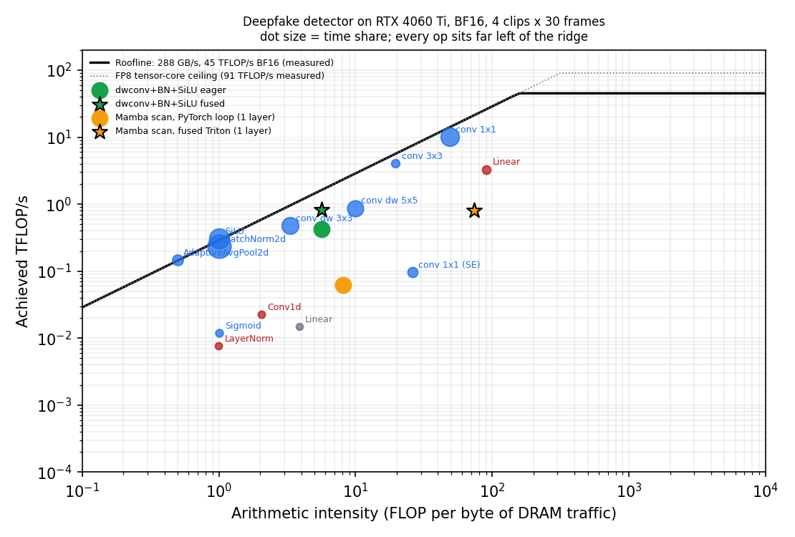

# inference-kernels: full results and details

# inference-kernels

Profiling a video deepfake detector (EfficientNet-B0 + Mamba, the November 2026 `dfmamba` rewrite) against the roofline of an RTX 4060 Ti, then writing two Triton kernels for the parts that waste the most time.

**Result:** 2.3x faster forward pass for one 30-frame clip (22.6 -> 9.6 ms), 1.5x at four clips, with outputs matching the original model to 9e-7.



Full write-up: **[WRITEUP.md](../WRITEUP.md)**.

## Current results (12 November 2026)

The sections below this one describe the first Triton work. The newer work, with numbers and caveats, is in [WRITEUP.md](../WRITEUP.md) under "Current results":

- **Official kernel race:** our CUDA selective scan against the official `mamba-ssm` kernel (vLLM's scan is the same kernel). fp32: faster on 11 of 12 shapes with per-shape tuned settings (1.67x to 14.85x) and also with one fixed setting for every shape, (16 channels, split 2), 1.63x to 11.46x; one loss at one long sequence (B1 E1024 T3000: 0.94x). bf16 rerun with an idle check before every row, fixed setting: faster on all 12 shapes, 1.33x to 11.47x. With the L2 cache flushed before every call the advantage shrinks (1.03x to 4.96x on most rows) and three batch-1 long-sequence rows become losses (0.87x to 0.91x). Table and caveats: [compare_official/README.md](../compare_official/README.md); data: `results/official_compare.json` (`scan`, `scan_fixed`).
- **Optimization ladder (frozen model):** batch-1 latency 6.85 to 0.78 ms (8.8x), batch-64 throughput 1,324 to 3,706 images/s (2.8x), accuracy unchanged (71.44% to 71.47%). Most of the batch-1 gain is the CUDA graph step, not the custom kernels. Table: `results/trained_ladder.md`.
- **Optimization ladder (fine-tuned v2 model):** batch-1 latency 3.73 to 0.60 ms (6.2x), batch-64 throughput 1,015 to 2,877 images/s (2.8x), 0.119 to 0.048 J per image (2.5x), accuracy unchanged (0.8962 to 0.8958). Same pattern: the CUDA graph gives the batch-1 gain; INT8 and FP8 on the head make it slower.
- **Streaming (one frame at a time):** recomputing a 30-frame window costs 4.31 ms per frame; one recurrent Mamba step in a CUDA graph costs 1.39 ms (3.1x), with a constant 0.275 MB state. Head only, the step is 15x to 46x faster than recomputing at windows of 30 to 3,000 frames. `results/streaming.md`.
- **Per-layer quantization (v2 model):** weights-only int8 costs at most 0.1 point per layer; the first depthwise layer at W8A8 loses 13.6 points per-tensor and 0.03 with per-channel activation scales. The best mixed plan speeds the model up by 1% to 3.5% only, so quantization barely helps this detector on this GPU (WRITEUP section 9).
- **CUDA kernel:** `cuda/selective_scan.cu`, fp32 error about 1e-6 against the reference.
- **Fused streaming kernel (CNN tail + Mamba step):** fp32 gives 0 flips on all 10,905 Test images; bf16 (the timed mode) flips 68 for the DiLoCo-trained model (`results/stream_fused_correctness.json`). Final timing (`results/stream_fused.json`): bf16 batch 1, 0.904 ms per frame against 1.097 ms for the unfused PyTorch recurrent step (1.21x); fp32 batch 1 it is 4% slower (1.812 against 1.744 ms). A windowed-attention baseline with random weights is as fast or faster in 3 of 4 settings, so the fused path is not the fastest option measured. WRITEUP, "A fused CNN-to-SSM streaming path".
- **Superseded:** the earlier "CUDA about 4x faster than Triton" figure (3.84x / 3.96x in the old WRITEUP table) used untuned Triton timed per call. Do not quote it.

## Findings in one paragraph

Nothing in this model is compute-bound on this card. The highest-intensity layers reach 49-90 FLOP per byte, below the 157 FLOP/byte ridge point. BatchNorm and SiLU alone take 35% of op time just reading and rewriting activations. The Mamba selective scan, written as a Python loop, is limited by kernel launches rather than by the GPU. Its time is the same at batch 1 and batch 4, and a CUDA graph cuts the unmodified one-clip forward from 22.6 to 11.3 ms.

## Kernels

| Kernel | What it fuses | Speedup | Tested against |
|---|---|---|---|
| [`kernels/selective_scan.py`](../kernels/selective_scan.py) | discretization + recurrence + output for one Mamba layer; state stays in registers, FP32 | 13.3x at 30 frames, 116x at 3,000 (against a PyTorch loop, which is launch-bound) | PyTorch loop, 5 shapes, FP32 and BF16 |
| [`kernels/fused_dwconv_bn_silu.py`](../kernels/fused_dwconv_bn_silu.py) | depthwise conv + folded BatchNorm + SiLU, one DRAM write | 2.0x over the 16 EfficientNet-B0 blocks; up to 80% of 288 GB/s | PyTorch conv -> BN -> SiLU, 9 shapes, FP32, BF16, FP16 |

## Precision

FP8 (per-tensor) and INT8 (weight-only, per-channel) for the linear layers, with the scan recurrence kept in FP32: [`quantization/results/quant.md`](../quantization/results/quant.md). FP8 made this model slower, because its matmuls are too small to amortize on-the-fly activation scaling, and it lost about eight times BF16's precision. INT8 weight-only stayed close to BF16 numerically but needs a fused dequantize-matmul kernel to be faster. These are numerical-error measurements on untrained weights, not detection accuracy. Per-layer quantization on a trained model, with Test accuracy, is in `results/quant_layerwise/` (still running; sensitivity results are in `sensitivity_diloco.md`).

## Layout

```
env/            measure.py (bandwidth, BF16 and FP8 peaks) -> ceilings.json
profiling/      profile_detector.py, per_layer_table.md, results/ (1 and 4 clips)
roofline/       roofline_plot.py, roofline_4060ti.png
kernels/        the two Triton kernels, test_kernels.py, bench_kernels.py, results/bench.md
quantization/   fp8_int8_linear.py, results/quant.md
WRITEUP.md      problem, measurements, kernels, results, what did not work
```

## Run

Linux or WSL2 with an NVIDIA GPU (Triton needs Linux). Clone [deepfake-detector-mamba](https://github.com/chanakyagt/deepfake-detector-mamba) next to this repository, or set `DETECTOR_REPO` to its path.

```bash
pip install -r requirements.txt
python env/measure.py
python kernels/test_kernels.py
python kernels/bench_kernels.py
python profiling/profile_detector.py --dtype bfloat16 --clips 4
python quantization/fp8_int8_linear.py
python roofline/roofline_plot.py
```

Paths for trained checkpoints and scratch files are read from environment variables. The defaults are the old locations (a `/tmp` that was wiped once), so set them on a fresh checkout:

- `DFM_CKPT_ROOT` (default `/tmp`): folder holding `img_runs/diloco_H100/model.pt` and `bb_runs/ft_effnet_b0_*/model.pt`.
- `DFM_SCRATCH` (default `/tmp`): folder for power-sampling CSV files.
- `DETECTOR_REPO`: path to the detector repository.
- `MAMBA_OFFICIAL_REPO`, `MAMBA_OFFICIAL_BUILD`: official `mamba-ssm` checkout and its built extension (only for `compare_official/`; build flags in `compare_official/BUILD_OFFICIAL.md`).
- `TEST_DIR`, `IMG_CACHE`: Test image folder and feature cache for the trained-model scripts.

Environment used: RTX 4060 Ti 8 GB (sm_89), driver 610.60, WSL2 Ubuntu 26.04, PyTorch 2.14.0+cu130, Triton 3.8.0.

## License

MIT
